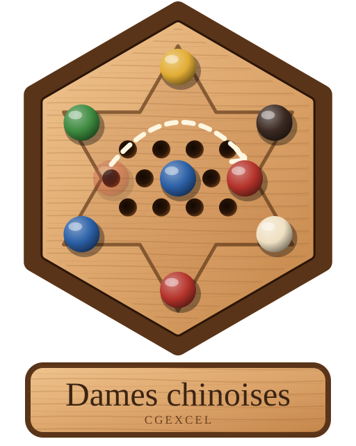

# Dames chinoises

Jeu de dames chinoises sur un plateau et des pions en bois, jouable sur
**smartphone** et sur **PC** directement dans le navigateur, et installable
comme une application (PWA, fonctionne hors ligne).

## Particularités

- **Mode Bonne-Maman** (coché par défaut) — **saut long** : un pion aligné avec un autre pion, séparé de lui par *n*
  trous vides, peut sauter par-dessus et retomber de l'autre côté en laissant
  *n* trous vides (tous ces trous et le trou d'arrivée doivent être libres).
  Avec *n* = 0, c'est le saut classique. Les sauts s'enchaînent. Sans le
  mode Bonne-Maman, seul le saut classique par-dessus un pion voisin est permis.
- **Plateau qui pivote** (option) : à chaque tour d'un joueur humain, le
  plateau tourne doucement pour amener son triangle en bas de l'écran.
- **Plateau inclinable** : glisser deux doigts vers le haut ou le bas (molette
  de la souris sur PC) pour incliner le plateau en perspective.
- **Déplacements animés** : on voit le pion sauter de trou en trou, avec un
  petit « toc » de bois à chaque atterrissage. Le dernier coup reste tracé et,
  en survolant un trou, on voit le chemin des sauts.
- **2 à 6 joueurs**, chacun humain ou ordinateur : l'ordinateur peut remplacer
  de 0 à 5 joueurs (et même tous, en démonstration), en 3 niveaux : facile,
  moyen, difficile.
- Les pions peuvent **traverser** les triangles des autres joueurs pendant
  leurs sauts, mais **pas s'y arrêter** : ils ne s'arrêtent qu'au centre,
  dans leur triangle de départ ou dans leur triangle d'arrivée.
- Annulation des coups, sauvegarde automatique de la partie en cours,
  plateau tourné pour que le premier joueur humain soit en bas.
- **Anti-blocage** : si votre pointe d'arrivée est pleine et que les pions
  adverses qui y restent (3 au plus) ne peuvent plus bouger, vous gagnez ;
  ils échangent leur place avec vos pions restés dehors.

## Jouer

Ouvrir `index.html` dans un navigateur (Chrome, Firefox, Safari, Edge).

Pour l'installer sur un smartphone, il faut le servir en HTTPS, par exemple
avec **GitHub Pages** : *Settings → Pages → Deploy from a branch → `main` /
`(root)`*. Ouvrir ensuite l'adresse sur le téléphone et choisir
« Ajouter à l'écran d'accueil ».

En local : `python3 -m http.server` puis http://localhost:8000.

## Fichiers

- `js/game.js` : règles (plateau, sauts longs, victoire, annulation)
- `js/ai.js` : joueur ordinateur
- `js/render.js` : dessin du plateau et des pions en bois
- `js/main.js` : interface, animations, son
- `sw.js`, `manifest.webmanifest` : application installable hors ligne

## Licence

Licence MIT + BAL 1.0 — Bonne Action License

En échange, une seule chose vous est demandée, sur l'honneur : faire une bonne action chaque jour. Aider un voisin, sourire à un inconnu, ramasser un papier… c'est vous qui voyez.

CGExcel — Cyrille Gindre — © 2026 — voir [LICENSE](LICENSE).
